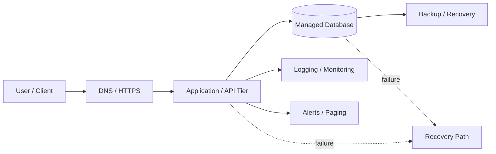

# Service Blueprint, SLOs & Cloud Cost Envelope

## Project
A small two-tier web service designed with service-flow mapping, SLO targets, error-budget thinking, three cloud-cost scenarios, and architecture decision records.

## 1. Service Blueprint



### Main paths
- Request path: User → HTTPS/DNS → Application/API → Database → Response
- Dependency path: Application depends on database, logging/monitoring, and secrets/configuration.
- Deployment path: Source code → build → cloud deployment → application instances.
- Data path: Application → database; database → backups.
- Failure path: application/database failure → monitoring alert → recovery/rollback/restore.

## 2. SLO Targets

| SLO | Lean | Balanced | Resilient |
|---|---:|---:|---:|
| Availability | 99.0% | 99.5% | 99.9% |
| P95 latency | 800 ms | 500 ms | 300 ms |
| RPO | 1440 min | 60 min | 15 min |
| RTO | 240 min | 60 min | 30 min |

### Error budget
For a 30-day month (43,200 minutes):
- 99.0% availability → 432 minutes allowed downtime
- 99.5% availability → 216 minutes allowed downtime
- 99.9% availability → 43.2 minutes allowed downtime

## 3. Cost Envelope

See `slo-cost-envelope.csv`.

| Scenario | Monthly Budget | Expected Users | Architecture |
|---|---:|---:|---|
| Lean | ₹2,500 | 500 | Single region, minimal managed services |
| Balanced | ₹8,000 | 5,000 | Managed database + autoscaling application tier |
| Resilient | ₹25,000 | 25,000 | Multi-zone services + tested backups |

These are planning envelopes from the supplied task data, not live cloud-provider quotes.

## 4. Architecture Decision Records

### ADR-001: Region
Use a primary region close to the application's target users to reduce latency. A second availability zone should be used for the resilient design.

### ADR-002: Recovery Objectives
Use RPO/RTO targets according to the selected scenario. Balanced provides a practical middle target; resilient targets faster recovery.

### ADR-003: Secrets
Store database credentials, API keys, and signing secrets in a managed secrets service or protected environment configuration. Never commit secrets to GitHub.

### ADR-004: Least-Privilege Access
Give each application component only the permissions it requires. Separate deployment, application, database, and monitoring permissions.

## 5. Recommended GitHub Structure

```text
cloud-slo-cost-envelope/
├── README.md
├── slo-cost-envelope.csv
├── service-blueprint.md
└── architecture-decision-records.md
```
